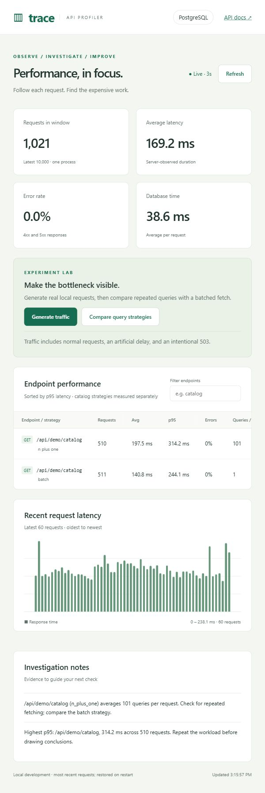

# API Performance Profiler

A small FastAPI app for finding out where an API spends its time. It records
request latency, errors, and SQL timings, then shows them in a live dashboard.
The included product API has two catalog implementations: one makes 101 queries,
the other returns the same data with a single query.



## Run with Docker

Install Docker Desktop and start its engine, then run:

```sh
git clone https://github.com/anshvashist0001/p1.git
cd p1
docker compose up --build -d --wait
```

Open the [dashboard](http://127.0.0.1:8001) or the
[interactive API docs](http://127.0.0.1:8001/docs).
Compose starts the API and PostgreSQL. Both product data and request history
survive container restarts in named volumes.

```sh
docker compose ps
docker compose logs --tail 50 app
docker compose stop
```

Use `docker compose up -d --wait` to start again. Rebuild after changing code.
`docker compose down` keeps the volumes; adding `-v` deletes their data.
The database password in Compose is a local demo credential, and published ports
bind to localhost. This setup is intended to run locally.

## Try the comparison

1. Click **Generate traffic** on the dashboard to populate the charts.
2. Compare the catalog strategies and inspect their query counts and latency.
3. Filter the endpoint table to `catalog` to see each strategy separately.
4. Restart the app and check that the request history returns.

Both strategies read the same 100 products. `n_plus_one` first reads their IDs,
then loads each product separately. `batch` reads all rows in one query.
The slow and error routes are deliberate examples for checking the charts.

The dashboard comparison warms both paths, then alternates their order for ten
requests each. Its client-side timings differ from the server summary, which
includes earlier traffic and warm-up requests.

## Run without Docker

Python 3.12 or later is required. SQLite works out of the box:

```powershell
python -m venv .venv
.\.venv\Scripts\python.exe -m pip install -r requirements.txt
.\.venv\Scripts\python.exe -m uvicorn app.main:app --reload --host 127.0.0.1 --port 8000
```

On macOS or Linux, use `.venv/bin/python` in place of
`.\.venv\Scripts\python.exe`. Open [localhost:8000](http://127.0.0.1:8000).
The app creates and seeds its database on startup.

To use PostgreSQL, install `requirements-postgres.txt` and set `DATABASE_URL`
before starting the server. On Windows, `scripts/local_postgres.py start` can
create a separate cluster using an installed PostgreSQL 18 distribution. It uses
`data/postgres` and port 5434; pass `--bin` if PostgreSQL is installed elsewhere.
`start-project.ps1` starts this cluster and the API after the Python environment
and PostgreSQL dependencies have been installed.

| Setting | Default | Purpose |
| --- | --- | --- |
| `DATABASE_URL` | Unset | PostgreSQL connection URL; overrides `DATABASE_PATH` |
| `DATABASE_PATH` | `data/demo.db` | SQLite product database |
| `METRICS_PATH` | `data/metrics.db` | SQLite request history, including with PostgreSQL |
| `APP_PORT` | `8001` | Docker's host port for the API |

## Tests

Run the full suite, including PostgreSQL, inside Docker:

```sh
docker compose exec -T -e TEST_DATABASE_URL=postgresql://profiler:local-profiler-dev@db:5432/profiler app python -m unittest discover -s tests -v
```

Or run locally:

```powershell
.\.venv\Scripts\python.exe -m unittest discover -s tests -v
```

The PostgreSQL test is skipped locally unless `TEST_DATABASE_URL` points to a
running demo database. Tests check catalog equivalence, query counts, concurrent
request isolation, errors, route grouping, aggregation, and history recovery.
GitHub Actions runs the suite with PostgreSQL on pushes and pull requests.

## Benchmark

The [saved benchmark](reports/benchmark.md) compared 1,000 measured requests
across five rounds at concurrency five. Batching reduced the median round-average
latency from 195.07 ms to 154.87 ms (20.6%) on that machine.
This was a native Windows/PostgreSQL run on 1 November 2026, before the later
readability edits. The JSON report retains the original source fingerprint.

To run a new comparison against Docker, install the local Python environment
above and run:

```powershell
.\.venv\Scripts\python.exe scripts/benchmark.py --base-url http://127.0.0.1:8001 --rounds 5 --requests 100 --concurrency 5 --warmup 10
```

Use port 8000 for the native app. The runner checks every response against the
reference catalog and writes new reports to `reports/`. Keep other traffic off
the app during the run. Results depend on the machine and workload.

## What the measurements cover

- Only `/api/` requests are recorded. Dashboard and monitoring reads are excluded.
- Request time ends when the app sends the final response body. Client network
  time is excluded; the benchmark measures client-observed latency separately.
- SQL time covers execution and fetching through the query helper. It excludes
  connection setup and serialization.
- p95 uses nearest rank. Error rates include both 4xx and 5xx responses.
- History retains the latest 10,000 samples. Writes happen after the response;
  a failed write leaves live metrics available and marks persistence as degraded.
- Run one API worker. Cross-process aggregation and connection pooling are not
  implemented. Query-share hints help investigation but do not prove a root cause.
- Request bodies, headers, SQL parameters, and arbitrary query strings are not saved.
  Monitoring has no authentication, so keep this demo local.

## Code map

| Path | Contents |
| --- | --- |
| `app/main.py` | Routes and app setup |
| `app/monitoring.py` | Request timing, bounded history, and summaries |
| `app/database.py` | Product data and SQL timing |
| `app/static/` | Dashboard; plain HTML, CSS, and JavaScript |
| `scripts/` | Load generator, benchmark, and native PostgreSQL helper |
| `tests/` | Backend and persistence tests |
| `compose.yaml` | API and PostgreSQL containers |

See the [architecture notes](docs/ARCHITECTURE.md) for the request lifecycle,
[verification record](docs/VALIDATION.md) for previous checks, and
[project discussion notes](docs/PORTFOLIO.md) for a short demo walkthrough.
