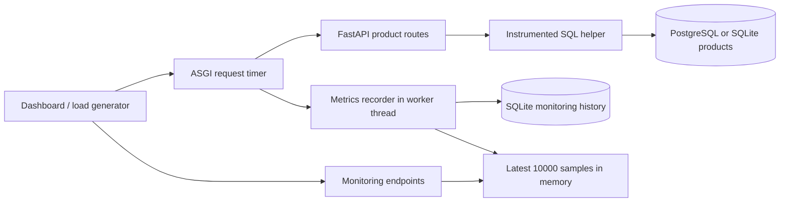

# Architecture and analysis

The application measures its own sample API. It is a local, single-worker profiler,
not yet a distributed monitoring platform or an automatic root-cause detector.

## Request lifecycle

1. Middleware starts a monotonic timer and creates request-scoped query counters.
2. The route opens a database connection. Each instrumented query measures execute
   and fetch time; parameter values are never retained in monitoring history.
3. The response status and final body-send time determine the request sample.
4. A worker thread appends the sample to the bounded window and commits it to a
   separate SQLite database. Disk work does not block the event loop. A lock orders
   concurrent writes and snapshots within this process.
5. The dashboard polls summary and recent-request endpoints every three seconds.

## Persistence

Startup restores the retained window, pruning older records beyond the configured
capacity. Each insert and retention cleanup is one transaction. SQLite WAL mode
is enabled. Startup fails visibly if existing storage cannot be restored; a later
write failure keeps live metrics working and marks persistence as degraded.

History uses SQLite even when product queries use PostgreSQL, keeping monitoring
storage independent of the business database. `METRICS_PATH` selects its location.
One Uvicorn worker is required: each process owns its own in-memory window.
Writes occur after the response, so an abrupt crash can lose an in-flight sample.
This is bounded history, not an indefinite archive. The request timer excludes
the persistence write, but that work still consumes resources during load tests.

## Analysis exercise

The catalog's N+1 implementation fetches 100 IDs, then performs 100 detail queries.
The batch implementation fetches the identical ordered rows with one query.
Integration tests prove response equivalence and request-scoped query counts.
The benchmark warms both strategies and alternates execution order across rounds.
The synthetic delay endpoint validates latency tracking and is excluded from this
optimization benchmark. Timing improvements must be stated with workload and environment.

## Docker runtime

Compose runs `app` and `db` on a private project network. The API connects to
`db:5432` after its database healthcheck passes; the browser connects through
loopback port 8001. Dashboard files are packaged with the API. PostgreSQL product
data and SQLite monitoring history use separate named volumes, which survive
container recreation. The API runs as UID 10001 with one worker. Native mode
continues to use port 8000 and separate local data files.

## Boundaries and extensions

- No request bodies, headers, SQL parameters, or arbitrary query strings are saved.
- Route templates and allowlisted strategy names prevent unbounded label growth.
- p95 is nearest-rank; error rates include both 4xx and 5xx.
- Connection time is included in request duration but excluded from SQL time.
- Investigation notes are heuristics, not confirmed root causes.
- Authentication, distributed aggregation, connection pooling, traces across
  services, CPU/memory profiling, and public deployment are outside this demo.
